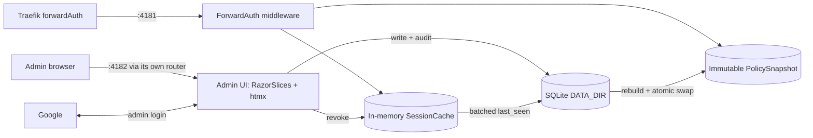

# C# Native AOT Port + Management Frontend: Plan

Decisions:
- Environment variables only configure how you log in to the admin interface: a Google OAuth client and an email allowlist. Everything else is managed in the admin UI and stored in SQLite.
- Forward auth keeps all existing providers (Google, OIDC, generic-oauth), configured in the UI.
- Admin login supports only Google for now. It is built on the same provider code so other providers can be added later.
- Admin UI: htmx + RazorSlices.
- The Go code is replaced in place.
- Runtime async is enabled.
- Rules are built from conditions in a form. There is no expression language, and the Traefik rule syntax is dropped.
- No INI file, no CLI flags, no legacy options.

## Platform decisions

| Decision | Choice | Reason |
|---|---|---|
| Target | `net11.0` (SDK 11.0.100) | Runtime async requires .NET 11. STS release, not LTS. |
| Runtime async | `<Features>$(Features);runtime-async=on</Features>` | Supports NativeAOT per the [.NET 11 runtime docs](https://learn.microsoft.com/en-us/dotnet/core/whats-new/dotnet-11/runtime). Still preview; escape hatch: `<UseRuntimeAsync>false</UseRuntimeAsync>`. |
| Host | `WebApplication.CreateSlimBuilder`, Kestrel with two listeners (forward-auth, admin) | AOT-safe, minimal hot path. |
| AOT flags | `PublishAot`, `InvariantGlobalization`, `IsAotCompatible`, IL2xxx/IL3xxx warnings as errors | Prevents reflection creep. |
| JSON | `System.Text.Json` source-generated context only | AOT requirement. |
| JWT/OIDC | Hand-written discovery + JWKS + JWT validation with `System.Security.Cryptography` | Avoids reflection-heavy `Microsoft.IdentityModel`. |
| Storage | `Microsoft.Data.Sqlite` with hand-written SQL | AOT-safe; EF Core AOT support is still experimental. |
| Admin UI | RazorSlices + htmx | Blazor, MVC and Razor Pages don't support AOT. Razor templates are compiled at build time. |
| Container | Build on the .NET 11 SDK AOT image; run on `runtime-deps:11.0-noble-chiseled`; published to GHCR | The AOT binary links glibc, so `FROM scratch` no longer works. Chiseled includes CA certs and runs non-root. |
| CI/CD | GitHub Actions; each architecture builds natively on its own runner | Native AOT doesn't cross-compile across architectures easily; native runners avoid both cross-compiling and QEMU. |

## Environment variables

| Variable | Required | Default | Purpose |
|---|---|---|---|
| `ADMIN_GOOGLE_CLIENT_ID` | yes | | Google OAuth client used to log in to the admin UI |
| `ADMIN_GOOGLE_CLIENT_SECRET` | yes | | Secret for that client |
| `ADMIN_EMAILS` | yes | | Comma-separated Google accounts allowed into the admin UI |
| `PORT` | no | `4181` | Forward-auth listener |
| `ADMIN_PORT` | no | `4182` | Admin UI listener |
| `DATA_DIR` | no | `/data` | Location of the SQLite database |
| `LOG_LEVEL` | no | `warn` | `trace` / `debug` / `info` / `warn` / `error` / `fatal` / `panic` |
| `LOG_FORMAT` | no | `text` | `text` / `json` / `pretty` |

The three `ADMIN_*` variables control admin access. The others are deployment settings with defaults; they're needed before the database is opened. The process exits with code 1 if any required variable is missing.

The admin Google OAuth client must register the redirect URI `https://<admin-host>/auth/callback`.

## Phase 1: core forward-auth engine (headless)

Phase 1 ports the Go behaviour onto an in-memory `PolicySnapshot` model. Configuration no longer comes from env/INI, so Phase 1 can't be released on its own; the first release ships at the end of Phase 2.

### Layout

```
TraefikForwardAuth.slnx
src/TraefikForwardAuth/
  Policy/         PolicySnapshot, Settings, RuleDefinition, AccessEntry, ProviderSettings, CookieDomain
  Rules/          Condition model, ConditionCompiler, host/path/glob matchers, PathNormalizer, RuleEvaluator, RuleDescriber
  Auth/           CookieService, CsrfService, AccessValidator, Nonce, ISessionStore + in-memory store
  Providers/      IProvider, Google, GenericOAuth, Oidc, OAuth2Client, Oidc/{Discovery,JwksCache,JwtValidator}
  Http/           ForwardAuthMiddleware, handlers (Allow/Auth/Callback/Logout), GoHttpCompat
  Logging/        logrus-compatible text/json/pretty console formatters
  Json/           AppJsonContext
tests/TraefikForwardAuth.Tests/   (xUnit v3)
```

### Steps

1. **Policy model**: an immutable `PolicySnapshot` containing:
   - settings: cookie name, CSRF cookie name, cookie domains, auth host, insecure cookie, URL path, lifetime, logout redirect, default action, default provider, match-whitelist-or-domain
   - compiled rules
   - access index
   - configured provider instances

   Requests read the current snapshot without locks; changes swap in a new one atomically.
   - If no provider is configured, every auth request gets a 503 ("not configured"). Nothing is allowed through.
2. **Rule matching**: conditions are built in the UI, so there is no parser.
   - A rule has a name, enabled flag, action (`Require login` / `Allow without login`), provider, position in the list, and one or more conditions.
   - How a rule matches:
     - all of its conditions must match;
     - the values within one condition are alternatives (any one is enough);
     - each condition can be negated ("is not").
   - Order: the reserved callback/logout paths are checked first. Then rules run top to bottom and the first match wins. If nothing matches, the default action applies.

     | Field | Operators | Values | Example |
     |---|---|---|---|
     | Host | is, matches wildcard | Hostnames; `*.example.com` matches any subdomain at any depth, not `example.com` itself | `app.example.com`, `*.example.com` |
     | Path | is, starts with, matches pattern | `*` matches within one segment, `**` across segments | `/api/`, `/users/*/avatar`, `/static/**` |
     | Method | is | HTTP method checkboxes | GET, HEAD |
     | Header | equals, contains, exists, matches regex (advanced) | Header name + values | `X-Api-Client` exists |
     | Query parameter | equals, exists | Parameter name + values | `token` exists |

   - Host matching ignores case and the port. Header names ignore case; header and query values are case-sensitive.
   - Paths are case-sensitive and normalized before matching: percent-decoded once, `.`/`..` resolved, `//` collapsed. This stops `/public/../admin` from slipping past an "Allow" rule on `/public`.
   - Paths with an encoded `/` or `\` (`%2F`, `%5C`) or control characters are rejected with 400.
   - Conditions are compiled when the snapshot is built. Host, path and glob checks are plain string/segment comparisons with no regex. Only "matches regex" uses `Regex`, with `RegexOptions.NonBacktracking` so a bad pattern can't hang a request (catastrophic backtracking).
   - Each rule also gets a plain-language summary, e.g. "Requests to `*.example.com` where path starts with `/api` and method is GET or HEAD → Allow without login".
3. **Access validation**:
   - Access entries have a scope (global or one rule), a kind (email or domain), a value, and an optional role. They replace the position-matched whitelist/roles lists.
   - As in Go, rule entries override global ones, and the match-whitelist-or-domain logic is unchanged.
   - Response headers: `X-Forwarded-User` and `X-Forwarded-Role`.
4. **Cookies/sessions**:
   - Auth cookie: `base64url(HMAC-SHA256(secret, domain‖email‖expires‖sid))|expires|email|sid`.
   - `sid` is a random 128-bit session id, so sessions can be revoked. Revocation is checked against an in-memory `ISessionStore` (no I/O per request).
   - The signing secret is generated on first boot. Go-issued cookies aren't accepted, so users log in again once after migrating.
   - CSRF keeps the Go behaviour: 32-hex nonce, cookie `<name>_<nonce[:6]>`, state `nonce:provider:returnUrl`. `useAuthDomain` and cookie-domain matching are unchanged.
5. **Request handling**:
   - Method, host and URI come from `X-Forwarded-Method`, `X-Forwarded-Host` and `X-Forwarded-Uri`. The return URL is path only, as today.
   - Responses copy Go's `http.Error` (text/plain body with trailing `\n`, plus `nosniff`) and `http.Redirect` (307 with `Location`).
6. **Providers**:
   - Google: direct port.
   - `OAuth2Client`: copies Go oauth2's auth-style detection (credentials in a header first, then in the form body). Accepts JSON or form-encoded token responses; reads `id_token` for OIDC.
   - Generic OAuth: token sent as a `header` or `query` parameter; default scopes `profile,email`; `resource` supported.
   - OIDC: discovery checks the issuer matches; JWKS keys are cached and refetched when an unknown key ID appears.
   - JWT checks: issuer, audience contains the client ID, expiry, signature. Allowed algorithms come from discovery, default RS256 (go-oidc v2 behaviour); RS, PS and ES families supported.
   - All provider calls use `IHttpClientFactory`.
7. **Logging**: formatters that reproduce logrus output.
   - text: `time="…" level=… msg="…" k=v`
   - json: `level`, `msg`, `time` plus fields
   - pretty
   - Levels trace…panic are mapped; fatal and panic map to Critical.
8. **Tests**:
   - Port the Go auth, server and provider tests, adjusted for the new cookie format and policy model. The Go config tests are dropped because flag/INI parsing no longer exists.
   - Add table-driven tests for every condition type and operator, negation, rule order, and path normalization (dot segments, encoded slashes, duplicate slashes).
   - Fake OAuth/OIDC servers on in-process Kestrel; signed test JWTs via `RSA.Create`. Handler tests use `TestServer`.

### Done when

- All ported and new tests pass.
- The AOT publish has zero warnings.

## Phase 2: storage + admin UI (first release)



### Storage

- WAL mode; numbered embedded migrations tracked with `PRAGMA user_version`. The database file is created with `0600` permissions.
- Tables:
  - `settings`: the policy settings from Phase 1 step 1, plus the generated signing secret.
  - `providers`: Google / OIDC / generic-oauth settings, including client secrets.
  - `rules`: name, `position`, action, provider, enabled, `conditions` (JSON through the source-generated context, validated on save).
  - `access_entries`: scope, kind, value, optional role.
  - `sessions`: id, kind (forward-auth or admin), email, provider, created/expires/last_seen, IP, user agent, revoked_at.
  - `audit_log`: time, admin email, action, entity, JSON diff.
- First boot creates an empty database with default settings and a new secret. Forward-auth fails closed until a provider is configured.
- Every admin write runs in a transaction, appends to `audit_log`, rebuilds the snapshot, and swaps it in.
- Sessions are loaded into `SessionCache` at startup. `last_seen` updates are batched through a `Channel`.

### Admin authentication

- Runs only on `ADMIN_PORT` (exposed through its own Traefik router), so it is never reachable through the forward-auth path.
- Login flow:
  - `/auth/login` redirects to Google using the `ADMIN_GOOGLE_*` client.
  - `/auth/callback` checks the CSRF state, exchanges the code, and fetches userinfo.
  - Access is granted only if `verified_email` is true and the email (compared case-insensitively) is in `ADMIN_EMAILS`.
- `redirect_uri` is built from `X-Forwarded-Proto` and `X-Forwarded-Host`. Google rejects anything not registered, so a spoofed host fails at Google.
- Admin session: a separate `_tfa_admin` cookie (host-only, `Secure`, `HttpOnly`, `SameSite=Lax`, 8h), stored as an `admin` row in `sessions` so it can be revoked.
- `ADMIN_EMAILS` is re-checked on every request, so removing an email from the env and restarting cuts off access immediately.
- Built for more providers later:
  - Admin login uses the same `IProvider` implementations as forward auth; only the Google instance is created from env for now.
  - `User` carries an `EmailVerified` flag: Google's `verified_email` now, OIDC's `email_verified` claim later.
  - Adding a provider later means an `ADMIN_PROVIDER` selector (default `google`, so existing deployments keep working) plus `ADMIN_OIDC_*` / `ADMIN_GENERIC_OAUTH_*` variables. The login flow itself doesn't change.

### Pages

- **Settings**: cookie and domain settings, auth host, lifetime, default action/provider, logout redirect, and "rotate secret" (logs out all users).
- **Providers**: Google / OIDC / generic-oauth. Secrets are write-only (never shown again). "Test connection" runs OIDC discovery or checks the endpoints.
- **Rules**:
  - Ordered list with move up/down (first match wins) and an enabled toggle.
  - The editor is a form: action, provider, and a condition builder. "Add condition" adds a row; picking a field swaps in its operators and value inputs (htmx); values go one per line.
  - While you edit, the form shows the plain-language summary and any validation errors.
  - A "Who can access" section edits that rule's emails, domains and roles.
  - "Simulate request": enter method, host, path, headers and query, and see which rule matches, which conditions passed or failed, and the final decision.
- **Users & access**: global and per-rule emails, domains, and roles.
- **Sessions**: forward-auth sessions only. List and filter, revoke one, revoke all for a user.
- **Admin sessions**: admin UI sessions only. Shows email, IP, user agent, created and last seen, with the current session marked. Revoke one or all for an admin. Revoking your own session logs you out.
- **Audit log**: read-only.
- Hardening: antiforgery token on every htmx form, Razor auto-encoding, htmx and minimal CSS embedded in the binary (no CDN).
- First step: a spike confirming RazorSlices 0.12.x compiles under net11 + AOT + runtime async with zero warnings. Fallback: hand-written templates using `HtmlEncoder`.

### Release

- Dockerfile: single-arch AOT build for the runner's architecture (no `--platform` cross-compile), non-root, `VOLUME /data`.
- GitHub Actions (`.github/workflows/ci.yml`), replacing the current QEMU + buildx multi-platform job:
  - `test`: `ubuntu-latest`, `dotnet test`.
  - `build` (needs `test`): matrix `amd64` → `ubuntu-24.04`, `arm64` → `ubuntu-24.04-arm`. Each job runs `dotnet publish` (AOT/trim warnings fail the build), then builds the image and pushes it to `ghcr.io/ivanjx/traefik-forward-auth` by digest. Separate GHA cache scope per architecture.
  - `manifest` (needs `build`): `docker buildx imagetools create` merges both digests into the multi-arch `:latest` tag.
  - Same triggers as today (`push` to `master`, `workflow_dispatch`); logs in to GHCR with `GITHUB_TOKEN` (`packages: write`).
- Delete the Go code, `go.mod`/`go.sum`, the `Makefile`, and `test/` (Go INI fixtures).
- Rewrite the README for the new env variables, admin UI setup, and Google redirect URI registration.
- Rewrite the examples: keep the Traefik wiring, replace the forward-auth config with the new env variables, and add the admin router plus the data volume.
- Perf check: load-test the auth endpoint on the Go and C# binaries (valid cookie; throughput and p99), C# with runtime async on and off.

### Done when

- On a fresh container, an admin in `ADMIN_EMAILS` logs in with Google, configures a provider, a rule and an access entry, and a request through Traefik is authenticated against them.
- Revoking that session in the UI makes the next forward-auth request redirect to login.

## Risks

- **Path matching can still differ from how a backend parses paths.** Ambiguous encodings are rejected, but "Allow" rules on path prefixes still deserve care.
- **Breaking change for existing deployments**: env/INI config, CLI flags, Traefik rule syntax and Go cookies no longer work. Each deployment has to be reconfigured through the UI.
- **Provider secrets are stored in plain text in SQLite**, protected only by file permissions and the non-root container. Database backups contain them.
- **SQLite means a single instance**: session revocation doesn't reach other replicas. Run one replica with a persistent `DATA_DIR` volume.
- **Runtime async is preview; .NET 11 is STS** (about 2 years of support).
