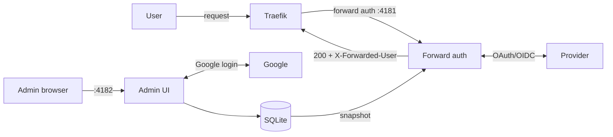

# Traefik Forward Auth

A forward authentication service for [Traefik](https://traefik.io), rewritten in C# as a Native AOT application.

It provides OAuth/SSO login for any HTTP service behind Traefik and an admin UI for managing providers, access rules, and sessions. Configuration lives in SQLite; only admin login and deployment settings come from environment variables.

## How it works



- Traefik calls the forward-auth listener on port `4181` for every protected request.
- The admin UI listens on port `4182`. Expose it through its own Traefik router; it is not reachable through the forward-auth listener.
- Policy changes are written to SQLite, audited, compiled into an immutable snapshot, and swapped in atomically.

## Quick start

```yaml
services:
  traefik:
    image: traefik:v3
    command:
      - --providers.docker
      - --entrypoints.web.address=:80
      - --entrypoints.websecure.address=:443
    ports:
      - "80:80"
      - "443:443"
    volumes:
      - /var/run/docker.sock:/var/run/docker.sock

  traefik-forward-auth:
    image: ghcr.io/ivanjx/traefik-forward-auth:latest
    environment:
      ADMIN_GOOGLE_CLIENT_ID: your-admin-client-id
      ADMIN_GOOGLE_CLIENT_SECRET: your-admin-client-secret
      ADMIN_EMAILS: you@example.com
    volumes:
      - tfa-data:/data
    labels:
      # Forward-auth service used by Traefik middlewares
      - traefik.http.services.traefik-forward-auth.loadbalancer.server.port=4181

      # Admin UI router
      - traefik.http.routers.tfa-admin.rule=Host(`tfa-admin.example.com`)
      - traefik.http.routers.tfa-admin.entrypoints=websecure
      - traefik.http.routers.tfa-admin.tls.certresolver=letsencrypt
      - traefik.http.routers.tfa-admin.service=tfa-admin
      - traefik.http.services.tfa-admin.loadbalancer.server.port=4182

      # Forward-auth middleware
      - traefik.http.middlewares.tfa.forwardauth.address=http://traefik-forward-auth:4181
      - traefik.http.middlewares.tfa.forwardauth.authResponseHeaders=X-Forwarded-User,X-Forwarded-Role

  whoami:
    image: traefik/whoami
    labels:
      - traefik.http.routers.whoami.rule=Host(`whoami.example.com`)
      - traefik.http.routers.whoami.entrypoints=websecure
      - traefik.http.routers.whoami.tls.certresolver=letsencrypt
      - traefik.http.routers.whoami.middlewares=tfa

volumes:
  tfa-data:
```

1. Register `https://tfa-admin.example.com/auth/callback` as an authorized redirect URI on the **admin** Google OAuth client.
2. Open `https://tfa-admin.example.com` and sign in with an address listed in `ADMIN_EMAILS`.
3. Add a forward-auth provider under **Providers**. Register the forward-auth callback URL, e.g. `https://whoami.example.com/_oauth`, on that provider's OAuth client.
4. Add an access entry under **Users & access** (email or domain).
5. Add a rule under **Rules**, or leave the default action as "Require login" to protect everything.

## Environment variables

| Variable | Required | Default | Purpose |
|---|---|---|---|
| `ADMIN_GOOGLE_CLIENT_ID` | yes | | Google OAuth client used to sign in to the admin UI |
| `ADMIN_GOOGLE_CLIENT_SECRET` | yes | | Secret for that client |
| `ADMIN_EMAILS` | yes | | Comma-separated Google accounts allowed into the admin UI |
| `PORT` | no | `4181` | Forward-auth listener |
| `ADMIN_PORT` | no | `4182` | Admin UI listener |
| `DATA_DIR` | no | `/data` | Directory containing the SQLite database |
| `LOG_LEVEL` | no | `warn` | `trace`, `debug`, `info`, `warn`, `error`, `fatal`, `panic` |
| `LOG_FORMAT` | no | `text` | `text`, `json`, `pretty` |

The process exits with code 1 when a required variable is missing or invalid. Everything else is configured in the admin UI.

### Google redirect URIs

The admin client must register:

```
https://<admin-host>/auth/callback
```

Each forward-auth provider has its own OAuth client. With Google, register the callback path for every host that uses the middleware:

```
https://app.example.com/_oauth
```

If you use **Auth host** in Settings, only the auth host needs to be registered:

```
https://auth.example.com/_oauth
```

## Admin UI

The UI is server-rendered with RazorSlices and htmx; both assets are embedded in the binary.

- **Settings**: cookie name and domains, auth host, callback path, lifetime, default action/provider, logout redirect, "match whitelist or domain", and secret rotation. Rotating the secret logs out every user.
- **Providers**: Google, OIDC and generic OAuth. Secrets are write-only; leaving the field blank keeps the stored secret. "Test connection" checks OIDC discovery or HTTP endpoints.
- **Rules**: ordered first-match rules with an enable toggle and move up/down. Conditions support host, path, method, header and query parameter. The editor shows a plain-language summary and validation errors, and can simulate a request.
- **Users & access**: global or per-rule email/domain entries with optional roles.
- **Sessions**: forward-auth sessions; filter by email, revoke one or all sessions for a user. Revoking a session makes the next protected request redirect to login.
- **Admin sessions**: admin UI sessions with IP, user agent, created and last seen. The current session is marked; revoking it signs you out.
- **Audit log**: read-only record of every admin write.

Every admin form carries an antiforgery token. Admin sessions are stored as `admin` rows so they can be revoked. `ADMIN_EMAILS` is checked on every request, so removing an address and restarting revokes access immediately.

## Rules

A rule has a name, action (`Require login` or `Allow without login`), optional provider, and one or more conditions. All conditions must match. Values inside one condition are alternatives and each condition can be negated.

| Field | Operators | Notes |
|---|---|---|
| Host | is, matches wildcard | Case-insensitive, port ignored. `*.example.com` matches `a.example.com` and `a.b.example.com`, not `example.com`. |
| Path | is, starts with, matches pattern | Case-sensitive. `*` stays within a path segment, `**` crosses segments. |
| Method | is | GET, HEAD, POST, PUT, PATCH, DELETE, OPTIONS, ... |
| Header | equals, contains, exists, matches regex | Header names are case-insensitive; values are case-sensitive. Regex uses non-backtracking matching. |
| Query parameter | equals, exists | Names and values are case-sensitive. |

Paths are decoded once, dot segments are resolved, and duplicate slashes are collapsed before matching. Paths containing `%2F`, `%5C` or control characters are rejected with `400` so they cannot bypass an "allow" rule.

The callback path (`/_oauth` by default) and `/_oauth/logout` are handled before rules. Otherwise rules run top to bottom and the first match wins. If nothing matches, the default action applies.

Access entries use the rule's own entries when it has any; otherwise the global entries apply. No entries means any authenticated user is allowed.

Signed-in users without access, or with an invalid cookie, get a `401` page with a sign-out button. Visiting `https://<host>/_oauth/logout` on any protected host signs out; with Google the next login shows the account chooser.

## Cookies and sessions

The forward-auth cookie is signed with a secret generated on first boot:

```
base64url(HMAC-SHA256(secret, domain + email + expires + sid))|expires|email|sid
```

`sid` is a random 128-bit session id checked against an in-memory cache. Sessions survive restarts because they are stored in SQLite; last-seen timestamps are batched. Revoking a session takes effect immediately.

## Data and deployment

- SQLite runs in WAL mode. The database file is created with `0600` permissions.
- Provider secrets are stored in plain text in SQLite. Protect the data volume; backups contain them.
- Run exactly **one replica** with a persistent `DATA_DIR`. Revocation does not propagate to other replicas.
- To reset the installation, stop the container and delete `traefik-forward-auth.db*` from `DATA_DIR`.

## Development

Requires the .NET 11 SDK (pinned in `global.json`). Runtime async is enabled by default; publish with `-p:UseRuntimeAsync=false` to disable it.

```bash
dotnet test TraefikForwardAuth.slnx
dotnet publish src/TraefikForwardAuth/TraefikForwardAuth.csproj -c Release -r linux-x64 -o publish
```

Native AOT and trimming warnings fail the build.

## License

MIT
