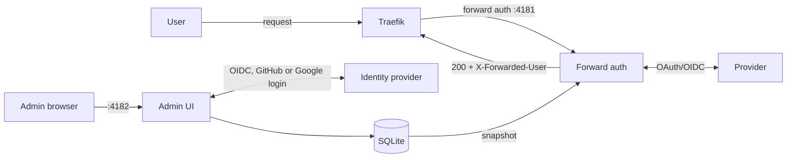

# Traefik Forward Auth

A forward authentication service for [Traefik](https://traefik.io), rewritten in C#.

It provides OAuth/SSO login for any HTTP service behind Traefik and an admin UI for managing providers, access rules, and sessions.

## How it works



- Traefik calls the forward-auth listener on port `4181` for every protected request.
- The admin UI listens on port `4182`. Expose it through its own Traefik router; it is not reachable through the forward-auth listener.
- The forward-auth listener trusts `X-Forwarded-Method`, `-Proto`, `-Host`, `-Uri` and `-For` from whoever calls it. Keep port `4181` reachable only from Traefik (no published port, internal network).

## Quick start

```yaml
services:
  traefik:
    image: traefik:v3
    command:
      - --providers.docker
      - --entrypoints.web.address=:80
      - --entrypoints.websecure.address=:443
    ports:
      - "80:80"
      - "443:443"
    volumes:
      - /var/run/docker.sock:/var/run/docker.sock

  traefik-forward-auth:
    image: ghcr.io/ivanjx/traefik-forward-auth:latest
    environment:
      # OIDC, GitHub or Google; see "Environment variables" for priority
      ADMIN_GITHUB_CLIENT_ID: your-admin-client-id
      ADMIN_GITHUB_CLIENT_SECRET: your-admin-client-secret
      ADMIN_EMAILS: you@example.com
    volumes:
      - tfa-data:/data
    labels:
      # Forward-auth service used by Traefik middlewares
      - traefik.http.services.traefik-forward-auth.loadbalancer.server.port=4181

      # Admin UI router
      - traefik.http.routers.tfa-admin.rule=Host(`tfa-admin.example.com`)
      - traefik.http.routers.tfa-admin.entrypoints=websecure
      - traefik.http.routers.tfa-admin.tls.certresolver=letsencrypt
      - traefik.http.routers.tfa-admin.service=tfa-admin
      - traefik.http.services.tfa-admin.loadbalancer.server.port=4182

      # Forward-auth middleware
      - traefik.http.middlewares.tfa.forwardauth.address=http://traefik-forward-auth:4181
      - traefik.http.middlewares.tfa.forwardauth.authResponseHeaders=X-Forwarded-User,X-Forwarded-Role

  whoami:
    image: traefik/whoami
    labels:
      - traefik.http.routers.whoami.rule=Host(`whoami.example.com`)
      - traefik.http.routers.whoami.entrypoints=websecure
      - traefik.http.routers.whoami.tls.certresolver=letsencrypt
      - traefik.http.routers.whoami.middlewares=tfa

volumes:
  tfa-data:
```

The same routers, services and middleware without Docker labels. Add `--providers.file.filename=/etc/traefik/dynamic.yml` to the Traefik command and mount the file there:

```yaml
# dynamic.yml
http:
  routers:
    tfa-admin:
      rule: Host(`tfa-admin.example.com`)
      entryPoints:
        - websecure
      service: tfa-admin
      tls:
        certResolver: letsencrypt

    whoami:
      rule: Host(`whoami.example.com`)
      entryPoints:
        - websecure
      service: whoami
      middlewares:
        - tfa
      tls:
        certResolver: letsencrypt

  services:
    tfa-admin:
      loadBalancer:
        servers:
          - url: http://traefik-forward-auth:4182

    whoami:
      loadBalancer:
        servers:
          - url: http://whoami:80

  middlewares:
    tfa:
      forwardAuth:
        address: http://traefik-forward-auth:4181
        authResponseHeaders:
          - X-Forwarded-User
          - X-Forwarded-Role
```

1. Register `https://tfa-admin.example.com/auth/callback` as the redirect URI on the **admin** OAuth client (OIDC client, GitHub OAuth app or Google OAuth client).
2. Open `https://tfa-admin.example.com` and sign in with an address listed in `ADMIN_EMAILS`.
3. Add a forward-auth provider under **Providers**. Register the forward-auth callback URL, e.g. `https://whoami.example.com/_oauth`, on that provider's OAuth client.
4. Add an access entry under **Users & access** (email or domain).
5. Add a rule under **Rules**, or leave the default action as "Require login" to protect everything.

## Environment variables

| Variable | Required | Default | Purpose |
|---|---|---|---|
| `ADMIN_OIDC_ISSUER_URL` | see below | | OIDC issuer used to sign in to the admin UI; discovery is read from `/.well-known/openid-configuration` |
| `ADMIN_OIDC_CLIENT_ID` | see below | | Client ID registered with that issuer |
| `ADMIN_OIDC_CLIENT_SECRET` | see below | | Secret for that client |
| `ADMIN_GITHUB_CLIENT_ID` | see below | | GitHub OAuth app used to sign in to the admin UI |
| `ADMIN_GITHUB_CLIENT_SECRET` | see below | | Secret for that app |
| `ADMIN_GOOGLE_CLIENT_ID` | see below | | Google OAuth client used to sign in to the admin UI |
| `ADMIN_GOOGLE_CLIENT_SECRET` | see below | | Secret for that client |
| `ADMIN_EMAILS` | yes | | Comma-separated email addresses allowed into the admin UI |
| `PORT` | no | `4181` | Forward-auth listener |
| `ADMIN_PORT` | no | `4182` | Admin UI listener |
| `DATA_DIR` | no | `/data` | Directory containing the SQLite database |
| `LOG_LEVEL` | no | `warn` | `trace`, `debug`, `info`, `warn`, `error`, `fatal`, `panic` |
| `LOG_FORMAT` | no | `text` | `text`, `json`, `pretty` |

Admin login needs one complete client: the three OIDC variables, the GitHub pair, or the Google pair. When several are set, the first complete one wins in the order OIDC, GitHub, Google. Setting only part of a group is an error.

OIDC discovery runs on the first admin login, not at startup. If the issuer is unreachable, the login page returns `503` and the next login tries again.

The process exits with code 1 when a required variable is missing or invalid. Everything else is configured in the admin UI.

### Email verification

GitHub sign-in, for both the admin UI and forward auth, uses the account's primary email (requested with the `user:email` scope) and is rejected when that email is not verified. Admin sign-in with Google requires Google's `verified_email` flag. Admin sign-in with OIDC requires an `email_verified: true` claim in the ID token; issuers that omit the claim cannot be used for the admin UI.

### Redirect URIs

The admin OAuth client (OIDC redirect URI, GitHub authorization callback URL or Google authorized redirect URI) must register:

```
https://<admin-host>/auth/callback
```

Each forward-auth provider has its own OAuth client. With Google, register the callback path for every host that uses the middleware:

```
https://app.example.com/_oauth
```

If you use **Auth host** in Settings, only the auth host needs to be registered:

```
https://auth.example.com/_oauth
```

A GitHub OAuth app has a single callback URL. GitHub accepts a `redirect_uri` whose host matches it excluding subdomains and whose path is under its path, so a callback of `https://example.com/_oauth` covers `https://app.example.com/_oauth`. Otherwise use **Auth host**.

## Rules

A rule has a name, action (`Require login` or `Allow without login`), optional provider, and one or more conditions. All conditions must match. Values inside one condition are alternatives and each condition can be negated.

| Field | Operators | Notes |
|---|---|---|
| Host | is, matches wildcard | Case-insensitive, port ignored. `*.example.com` matches `a.example.com` and `a.b.example.com`, not `example.com`. |
| Path | is, starts with, matches pattern | Case-sensitive. `*` stays within a path segment, `**` crosses segments. |
| Method | is | GET, HEAD, POST, PUT, PATCH, DELETE, OPTIONS, ... |
| Header | equals, contains, exists, matches regex | Header names are case-insensitive; values are case-sensitive. Regex uses non-backtracking matching. |
| Query parameter | equals, exists | Names and values are case-sensitive. |

Paths are decoded once, dot segments are resolved, and duplicate slashes are collapsed before matching. Paths containing `%2F`, `%5C` or control characters are rejected with `400` so they cannot bypass an "allow" rule.

The callback path (`/_oauth` by default) and `/_oauth/logout` are handled before rules. Otherwise rules run top to bottom and the first match wins. If nothing matches, the default action applies.

Access entries use the rule's own entries when it has any; otherwise the global entries apply. No entries means any authenticated user is allowed.

Signed-in users without access, or with an invalid cookie, get a `401` page with a sign-out button. Visiting `https://<host>/_oauth/logout` on any protected host signs out; with Google or GitHub the next login shows the account chooser.

## Development

Requires the .NET 11 SDK (pinned in `global.json`). Runtime async is enabled by default; publish with `-p:UseRuntimeAsync=false` to disable it.

```bash
dotnet test TraefikForwardAuth.slnx
dotnet publish src/TraefikForwardAuth/TraefikForwardAuth.csproj -c Release -r linux-x64 -o publish
```

Native AOT and trimming warnings fail the build.

## License

MIT
